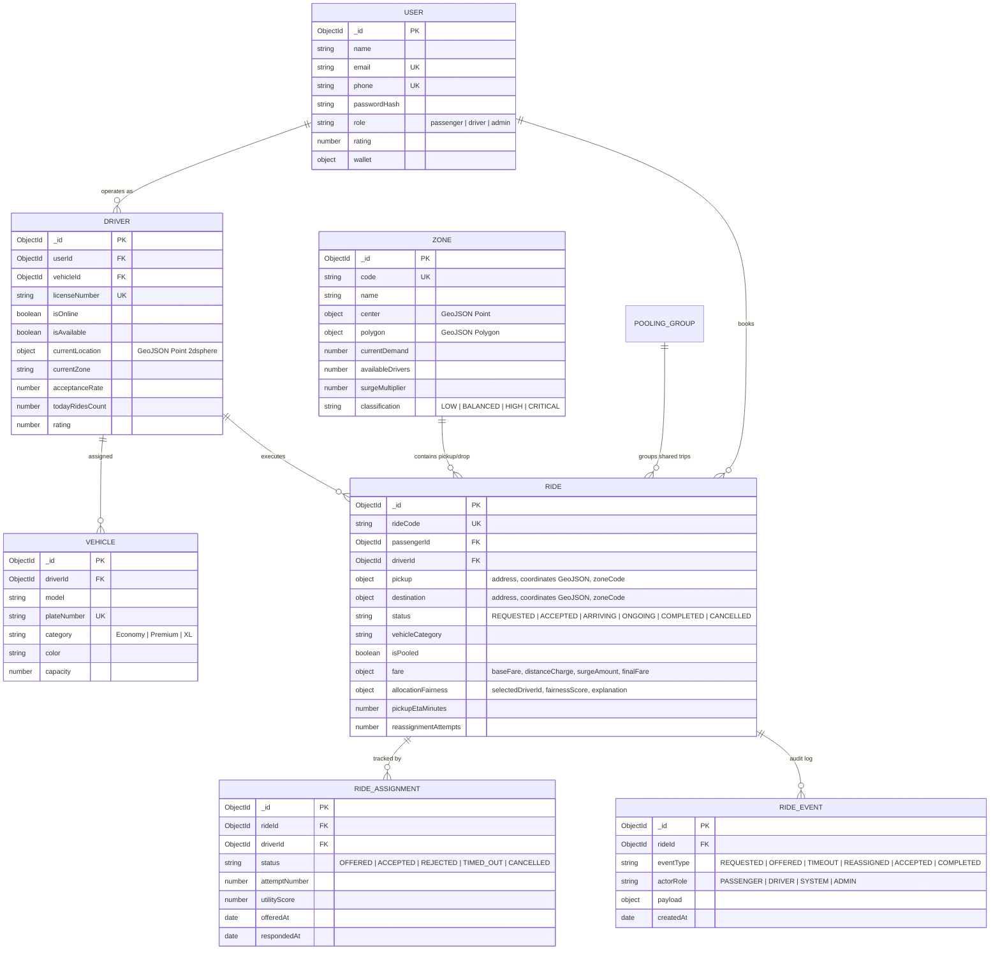

# Database Schema Specification
## VisionForge Mobility Platform (PS 02)

Database: `visionforge_ride` (MongoDB 7.0 / MongoMemoryServer fallback)

All spatial coordinates use GeoJSON `Point` format `[longitude, latitude]` with MongoDB `2dsphere` geospatial indexing.

---

## 1. Schema Entity Relationship

---

## 2. Geospatial Indexing

The following collections feature 2dsphere indexes for ultra-fast spatial search:
- `Driver.currentLocation`: `{ currentLocation: "2dsphere" }`
- `Ride.pickup.location`: `{ "pickup.location": "2dsphere" }`
- `Zone.center`: `{ center: "2dsphere" }`
- `Zone.polygon`: `{ polygon: "2dsphere" }`

