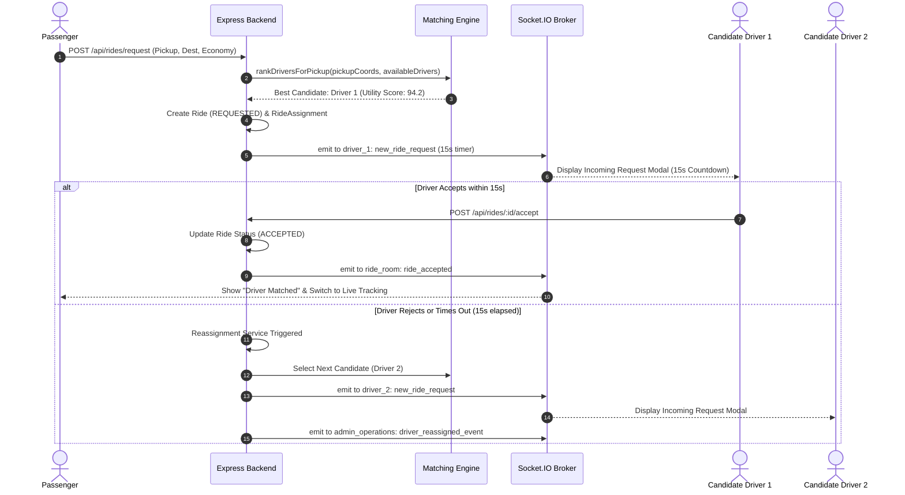

# System Architecture Document
## VisionForge Mobility Platform (PS 02)

This document details the architectural blueprint, data flows, and communication topologies of the VisionForge Intelligent Ride-Hailing Platform.

---

## 1. High-Level Architectural Diagram

```mermaid
flowchart TD
    subgraph ClientLayer ["Client Layer (React.js + Tailwind + Socket.IO)"]
        UI_Pass["Passenger App (Booking, Live Telemetry)"]
        UI_Drv["Driver Console (15s Request, GPS Simulation)"]
        UI_Admin["Admin Operations (Fleet Management, KPIs)"]
        UI_Intel["Intelligence Suite (ML Forecast, Surge, Fairness)"]
    end

    subgraph GatewayLayer ["API & Realtime Gateway (Node.js + Express + Socket.IO)"]
        HTTP_API["Express REST API (Port 5000)"]
        WS_Gateway["Socket.IO Event Broker (Port 5000)"]
        Auth_JWT["JWT Authentication & RBAC Middleware"]
    end

    subgraph CoreEngines ["Core Algorithmic Engines"]
        Engine_Matching["Multi-Factor Fairness Allocation Engine"]
        Engine_Zone["Zone Intelligence & Dynamic Surge Engine"]
        Engine_Pool["Ride Pooling Permutation Heuristic Engine"]
        Engine_Reassign["Automatic Reassignment & Exception Service"]
    end

    subgraph MLService ["Machine Learning Service (Python + FastAPI)"]
        FastAPI_App["FastAPI Service (Port 8000)"]
        Model_GBR["Scikit-Learn GradientBoostingRegressor (R²=0.93)"]
        Feature_Engine["Temporal & Geospatial Feature Extractor"]
    end

    subgraph DataStorage ["Persistence Layer"]
        DB_Mongo["MongoDB / MongoMemoryServer (Port 27017)"]
        Collections["Users, Drivers, Rides, Zones, DemandForecasts, RideEvents"]
    end

    UI_Pass -->|REST / Quote / Book| HTTP_API
    UI_Drv -->|REST / Status| HTTP_API
    UI_Admin -->|REST / Analytics| HTTP_API
    UI_Intel -->|REST / Forecasts| HTTP_API

    UI_Pass <-->|Socket.IO Telemetry| WS_Gateway
    UI_Drv <-->|Socket.IO Request (15s)| WS_Gateway
    UI_Admin <-->|Socket.IO Live Ops| WS_Gateway

    HTTP_API --> Auth_JWT
    Auth_JWT --> CoreEngines

    CoreEngines -->|Predict Demand| FastAPI_App
    FastAPI_App --> Model_GBR
    CoreEngines <--> DB_Mongo
```

---

## 2. Core Architectural Subsystems

### 2.1 Frontend Presentation Tier (React + Vite)
- **Framework**: React 18, Vite, Tailwind CSS with customized typography and dark/light accents.
- **State Architecture**: Local reactive hooks combined with centralized `localStorage` token management and Socket.IO real-time hooks.
- **Role Modes**:
  - `Passenger`: Geolocation selection via Belagavi landmark directory, upfront fare calculation across 3 tiers, animated driver radar search, live GPS telemetry tracking.
  - `Driver`: Online/offline state switch, 15-second request countdown timer with audio-visual notifications, turn-by-turn trip advance, earnings charts.
  - `Admin`: Multi-KPI performance tracking, driver fleet roster with search, operational zone heatmaps, exception logs.
  - `Intelligence`: Dedicated tabs for ML demand forecasting, sector surge calculation, ride pooling heuristics, fairness utility scoring, and auto-failover audits.

### 2.2 Backend Gateway & Event Engine (Node.js + Express)
- **REST Endpoints**: Modular controllers for `/api/auth`, `/api/passenger`, `/api/driver`, `/api/rides`, `/api/ml`, and `/api/admin`.
- **Socket.IO Event Gateway**:
  - `join_user_room`: Dedicated channel per user (`user_{id}`) and driver (`driver_{id}`).
  - `join_ride`: Dynamic ephemeral room (`ride_{id}`) connecting passenger and driver during an active trip.
  - `admin_operations`: Broadcast room for system-wide alerts, new rides, driver repositioning recommendations, and reassignments.
- **Failover Database Strategy**:
  - Default connects to local MongoDB on port 27017.
  - If a daemon is absent, the system boots an embedded `MongoMemoryServer` with full geospatial 2dsphere indexing and zero external configuration.

### 2.3 Machine Learning Pipeline (Python + FastAPI)
- **Model**: Scikit-learn `GradientBoostingRegressor`.
- **Dataset**: 12,960 simulated historical transit records across 6 Belagavi sectors with temporal attributes (`hour`, `day_of_week`, `is_weekend`, `historical_demand`).
- **Performance**:
  - $R^2 = 0.9301$
  - $\text{MAE} = 1.422$
  - $\text{RMSE} = 1.797$
- **High-Availability Architecture**: The Node.js backend connects to FastAPI on port 8000. If the Python process is temporarily stopped, the backend automatically invokes an embedded Scikit-learn heuristic predictor, ensuring zero user-facing service interruptions.

---

## 3. Communication Patterns

### Ride Request & 15-Second Allocation Lifecycle


